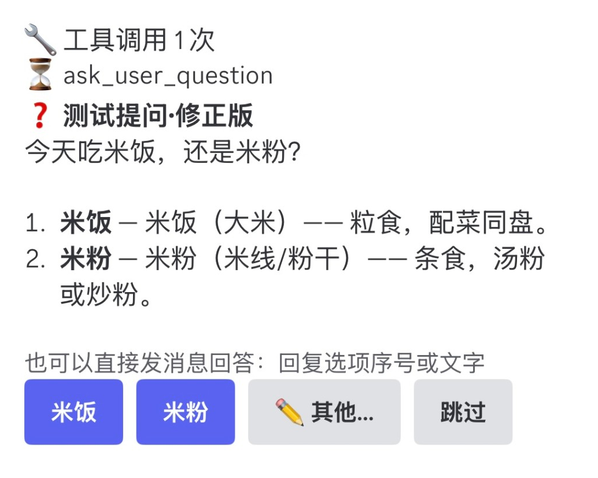

# dsh-plugin-discord

[中文](README.md) | English

A Discord bridge for DeepSeek Harness (dsh): from Discord on your phone or Mac, chat with sessions in **any workspace** of the DeepSeek client, attach to the session you have open on the desktop, approve tool calls, answer the model's questions, and stop a run at any time.



> The bot's messages in Discord (buttons, prompts, status lines) are currently in Chinese.

## How it works

The plugin is a standard dsh **bundle**. Once installed into the profile of the DeepSeek desktop app (or `dsh web`), it **runs inside the Harness Host process** and calls the same Host API the desktop UI itself uses (`ctx.sessionController`, `ctx.workspaceRegistry`):

- A session started from Discord is an ordinary session: it shows up right away in the desktop sidebar under its workspace, with the current default model, default agent preset, and permission settings.
- A session opened on the desktop can be attached from Discord (`/attach`); whichever side you type on, replies are mirrored to Discord.
- Tool approvals appear both in Discord (as buttons) and on the desktop, and **the first answer wins**; when Discord answers first, the desktop approval dialog closes by itself.
- The same goes for questions the model asks with `ask_user_question`: they appear in Discord and on the desktop, and the side that finishes answering first wins.
- No extra process and no open ports: the Discord bot only makes outbound connections.

How Discord maps onto the Harness:

| Discord | Harness |
|---|---|
| Direct message (DM) | One session; `/new` switches to a new one |
| Text channel | One default workspace (chosen with `/use`); a message posted in the channel opens a thread |
| Thread | One session; the thread is renamed once the session title is generated |

## 1. Create a Discord bot

1. Open <https://discord.com/developers/applications> → **New Application**.
2. **Bot** in the sidebar → **Reset Token**, and copy the token.
3. On the same page, turn on **Privileged Gateway Intents → MESSAGE CONTENT INTENT** (required; without it the bot cannot read message text).
4. **OAuth2 → URL Generator** in the sidebar: under Scopes tick `bot` and `applications.commands`; under Bot Permissions tick `View Channels`, `Send Messages`, `Create Public Threads`, `Send Messages in Threads`, `Manage Threads`, `Read Message History`, `Add Reactions`, and `Attach Files`. Use the generated link to invite the bot into your own server.
5. Get your user ID: Discord Settings → Advanced → turn on Developer Mode → right-click your avatar → Copy User ID.

> You can only DM the bot if you and the bot share a server.

## 2. Install the plugin

**Option A: desktop UI** — the **Plugins** page in the sidebar → Install → enter `dsh-plugin-discord` as the **Plugin package name** → click **Enable now** once it is installed.

**Option B: command line** (`dsh web` or any other profile):

```bash
dsh plugin --profile <profile> add dsh-plugin-discord
```

<details>
<summary>Install from source (for development)</summary>

```bash
git clone https://github.com/tjiisztiuv/dsh-plugin-discord.git
cd dsh-plugin-discord
npm install      # or pnpm install
npm run build    # produces lib/
dsh plugin --profile <profile> add "$PWD"
```

You can also enter the directory's absolute path in the install dialog on the Plugins page. A local path is installed as a link, so after changing the code you only need `npm run build` and then re-enable the plugin on the Plugins page (or restart).

</details>

## 3. Provide the token

The token is not written into the config; it is read through dsh's credential system (variable name `DISCORD_BOT_TOKEN` by default). Pick one:

- Put it in `~/.dsh/.env`: `DISCORD_BOT_TOKEN=xxxxx`
- Or put it in `~/.dsh/.credentials.yaml` (dsh's local credential store)

> `.env` is read only once, when the desktop app starts: after adding or changing it, **quit completely (Cmd+Q) and reopen**; re-enabling the plugin on the Plugins page does not pick up the new value. The variable name must match `tokenEnv` in the config exactly.

## 4. Configure it (required)

`allowedUserIds` is empty by default, and while it is empty the bot **does not go online** (the log says so). Override the `discord` row in the profile's own `cordis.patch.yml` — for the desktop app that is `~/.dsh/profiles/desktop/cordis.patch.yml`:

```yaml
- id: discord
  config:
    tokenEnv: DISCORD_BOT_TOKEN
    allowedUserIds: ['123456789012345678']     # your Discord user ID
    stateFile: !!js dshHomePath('discord', 'state.json')
    defaultWorkspace: my-project                # optional: workspace to use when none is chosen (title / path / ID)
    # allowedGuildIds: ['...']                  # optional: only respond in these servers
    # allowedChannelIds: ['...']                # optional: only respond in these channels (and their threads)
```

> A patch replaces the row's whole `config`, so restate every key you need. Profiles with HMR enabled reload on save; otherwise restart the desktop app.

### All options

| Key | Default | Description |
|---|---|---|
| `tokenEnv` | `DISCORD_BOT_TOKEN` | Credential name of the bot token |
| `allowedUserIds` | `[]` | User IDs allowed to use the bot; the bot stays offline while this is empty |
| `allowedGuildIds` | `[]` | Server allowlist; empty = no restriction (DMs are not affected) |
| `allowedChannelIds` | `[]` | Channel allowlist, threads match by parent channel; empty = no restriction (DMs are not affected) |
| `stateFile` | `~/.dsh/discord/state.json` | File that persists channel ↔ session bindings |
| `defaultWorkspace` | — | Workspace used when a channel has not chosen one |
| `timeZone` | Local time zone | IANA time zone sent with each prompt |
| `approvals` | `race` | `race`: Discord and the desktop both offer approvals, the first answer wins; `desktop`: approve on the desktop only |
| `questions` | `race` | `race`: model questions (`ask_user_question`) go to both Discord and the desktop, the first complete answer wins; `desktop`: answer on the desktop only |
| `toolCalls` | `compact` | `compact`: one editable tool-call progress message per turn; `off`: hidden |
| `showReasoning` | `false` | Show the model's reasoning as quotes |
| `mirrorDesktopInput` | `true` | Mirror messages typed on the desktop to Discord |
| `registerCommands` | `true` | Register global slash commands when the bot comes online |
| `commandPrefix` | `!` | Prefix for text commands |
| `messageChunkSize` | `1900` | Maximum characters per Discord message (limit 2000) |
| `sessionListLimit` | `10` | Number of sessions `/sessions` lists |
| `progressMaxLines` | `12` | Tool-call lines kept in the progress message |
| `progressEditIntervalMs` | `1500` | Minimum interval between progress message edits |
| `typingIntervalMs` | `8000` | Refresh interval of the "typing" indicator while a turn runs |
| `maxImageBytes` | `8 MiB` | Size limit for image attachments forwarded to the model |
| `approvalArgumentChars` | `900` | Characters of tool arguments shown on an approval card |
| `requestTimeoutMs` | `60000` | Timeout for Host API calls (create, send, list) |

## Usage

A plain message goes to the session bound here; if nothing is bound, a new session is started in the current default workspace (in a text channel, a thread is opened for it). Image attachments are sent to the model as image input; other attachments are added to the message as links.

| Slash command | Text command | What it does |
|---|---|---|
| `/ws` | `!ws` | List workspaces (👉 marks the current default) |
| `/use workspace` | `!use <name/number>` | Switch the workspace used here; if the session bound here belongs to another workspace, it is unbound and your next message starts a session in the new one |
| `/new [prompt] [workspace]` | `!new [text]` | Start a new session |
| `/sessions [workspace]` | `!sessions` | Recent sessions (▶️ running, 📍 bound here) |
| `/attach session` | `!attach <number>` | Attach an existing session, such as the one running on the desktop |
| `/detach` | `!detach` | Unbind (the session is not deleted) |
| `/stop` | `!stop` | Stop the current turn (queued messages are kept) |
| `/steer text` | `!steer <text>` | Steer a turn while it is running |
| `/status` | `!status` | Show the bound workspace and session |
| — | `!help` | Help |

The workspace and session arguments of slash commands autocomplete. Global commands can take a few minutes to appear in the client after they are first registered; text commands work in the meantime.

### Answering the model's questions

When the model calls `ask_user_question`, question cards appear one at a time in the bound channel (when it asks several questions, the next appears once the current one is answered):

- Single choice: one button per option, click to answer; in the plan review question (plan mode's `exit_plan_mode`), the approving option is a green button.
- Multiple choice: pick one or more options from a dropdown.
- `✏️ 其他…` (Other) / `✏️ 回答…` (Answer) opens a text box for a written answer; `跳过` (Skip) skips the question.
- You can also **reply with a plain message**: an option number (comma-separated for multiple choice, e.g. `1,3`), the option text, or any text. While a question is waiting, ordinary messages in the channel are taken as the answer.

With the desktop app open, both sides can answer, the first complete answer wins, and the card on the other side closes; with the desktop app closed, you answer in Discord only. When a timed question (`tool-ask-user` configured with `mode: timed`) times out, the model carries on and the card says it timed out.

A session is bound to one Discord location at a time: when you `/attach` the same session elsewhere, the previous location is told the session has moved.

## Security

- This plugin lets Discord messages drive the agent on your machine — reading and writing files, running commands — **which amounts to a remote shell**. Always set `allowedUserIds`, and only put the bot in your own private server.
- Approvals follow the session's own permission preset; under a full-access preset no approvals appear.
- Keep the token in local credentials only, and never commit it to a repository.

## Development

```bash
npm run typecheck          # type check
npm test                   # unit tests (vitest)
npm run typecheck:compat   # check the Host API types in src/dsh.ts against a sibling deepseek-harness checkout
```

The plugin deliberately does not depend on specific versions of `@deepseek-ai/dsh-*` packages: the Host API it uses is declared structurally in `src/dsh.ts`, and `typecheck:compat` catches incompatibilities when the Harness is upgraded. At runtime it uses only `@deepseek-ai/cordis` and `@deepseek-ai/schemastery` provided by the Host (peer dependencies) and `discord.js`.

Code layout:

| File | Responsibility |
|---|---|
| `src/index.ts` | Plugin entry: injects Host services, subscribes to `session/event`, `approval/request`, and `user-questions/request`, manages the bot lifecycle |
| `src/bridge.ts` | Discord-independent core: channel ↔ session bindings, sending prompts, rendering session events, racing approvals and questions |
| `src/commands.ts` | Slash command definitions and implementations (shared by slash commands and `!` text commands) |
| `src/discord.ts` | discord.js client: permission checks, message routing, interactions, buttons, the send-queue implementation |
| `src/state.ts` | JSON persistence of bindings |
| `src/format.ts` | Pure functions such as chunking (keeping code blocks intact) and tool-call summaries |
| `src/questions.ts` | Question card layout, buttons / dropdowns / text boxes, and parsing of direct replies |
| `src/dsh.ts` | Structural types of the Harness Host API it uses |

## Known limitations

- After a timed question times out, a late answer can only be given on the desktop (the Discord card says so).
- Replies are sent whole at the end of each model step, not streamed with live edits.
- A token in `~/.dsh/.env` only takes effect after fully restarting the desktop app; a token in `~/.dsh/.credentials.yaml` takes effect after re-enabling the plugin on the Plugins page.
